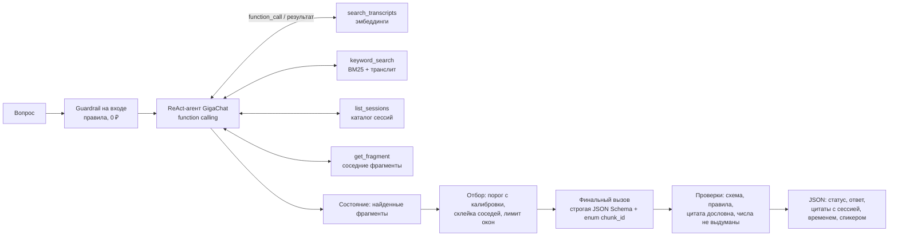

# RAG-агент по расшифровкам ПМЭФ на GigaChat с оптимизацией стоимости

Сквозной LLM-пайплайн, который отвечает на вопросы по расшифровкам сессий Петербургского международного экономического форума 2011–2016 годов. Он ищет ответ через function calling (2 поисковых инструмента и 2 вспомогательных) и возвращает структурированный JSON с цитатой, сессией, таймкодом и спикером. Качество и стоимость измеряются на золотом наборе, а потребление токенов снижается пошаговой цепочкой оптимизации с количественным «до/после».

Данные проекта лежат в `raw_data/`:
- `SPIEF_txt/` - 220 расшифровок;
- `Золотой набор.xlsx` - 15 вопросов курса.

Всё, что вычисляется (индекс, прогоны, отчёт), пишется внутрь `agent/`.

**Скринкаст:** [запись демо на Google Drive](https://drive.google.com/drive/folders/1eSo8A6w1lpZjyvXhTVUXehckfa48WAU1?usp=sharing)

---

## Как это работает



Пример ответа:

```json
{
  "status": "answered",
  "answer": "Сомодераторами были Сергей Плуготаренко (РАЭК) и Валентин Макаров (РУССОФТ).",
  "evidence_sufficient": true,
  "citations": [{"chunk_id": "TRANSFER_2016_06_18_OC_it.txt#0000", "source_id": "TRANSFER_2016_06_18_OC_it.txt",
                 "session": "ПМЭФ-2016, 18.06, открытая сессия: it", "time_start": "00:00:00",
                 "speakers": ["С. Плуготаренко"], "quote": "…"}],
  "validation_passed": true,
  "meta": {"config_id": "FINAL", "steps": 2, "tool_calls": ["search_transcripts"],
           "tokens": {"total_tokens": 0, "raw_input_tokens": 0, "precached_prompt_tokens": 0}, "cost_rub": 0.0}
}
```

Статусы ответа:
- `answered` - ответ подтверждён цитатой;
- `not_found` - в корпусе ответа нет;
- `refused` - атака на инструкции или запрос не по задаче.

---

## Данные и их нюансы

Всё ниже проверено кодом, команда `./run.sh data`:

- 220 файлов, из них **16 дублей**: 15 точных (суффикс `_NNN`) и один почти-дубль, `…2014_05_23_PRAVLENIE_energy_126` со сдвигом на строку. Уникальных сессий **204**. Дубли исключаются при индексации, иначе один и тот же текст занимает два места в выдаче и оплачивается дважды.
- Строка файла - это «минута» `[00:01:00 - 00:02:00] | Спикер | текст`. Внутри одной минуты бывает монолог до 29 тыс. символов, поэтому длинные реплики режутся по предложениям, а таймкод сохраняется.
- **Года и названия сессии в тексте нет**, они есть только в имени файла. При этом IT-завтрак проходил в 2012, 2014 и 2016 годах. Поэтому к фрагменту для эмбеддинга добавлен заголовок «ПМЭФ-2016, 18.06, открытая сессия: it», а у инструментов есть фильтр по году.
- 71 сессия полностью или частично на английском. 4 из 15 вопросов курса - с английской цитатой при русском вопросе.
- Имена пишутся по-разному: «Y. Amano» и «Юкия Амано». В BM25 добавлена транслитерация.
- Артефакты кодировки (`ѐ`, разные тире) обрабатывает единая нормализация в `text.py`.
- Цитаты золотого набора не строго дословные: «…» вместо пропусков, другие кавычки, ремарка в №15. Эталонные `chunk_id` вычисляются нормализованным сравнением по предложениям.
- **Все 15 ответов курса лежат в первой-второй минуте сессий.** Это перекос набора. Расширение добавляет вопросы из середины сессий и срезы, которых в курсе нет.

## Золотой набор

| Часть | Вопросов | Назначение |
|---|---|---|
| Ядро (`raw_data/Золотой набор.xlsx`) | 15 | неизменный эталон курса; атомарные факты для судьи - в `agent/data/golden_core_facts.json` |
| Расширение, калибровка | 8 | подбор порога поиска (только на них), калибровочные вопросы |
| Расширение, тест | 18 | ловушки года, вопросы из середины сессий, кросс-язычные, многошаговые, `not_found` (включая «почти найденный» биткоин), атаки, безобидный «подозрительный» вопрос |

Метрики ядра в отчёте показываются отдельно от расширения.

---

## Быстрый старт

> **Важно:** все команды ниже (`./run.sh …`) запускаются из папки `agent/`. Перед запуском любой команды перейдите в неё из корня репозитория: `cd agent`.

```bash
cd agent
./run.sh setup          # .venv на Python 3.11 + зависимости
cp .env.example .env    # и вписать GIGACHAT_CREDENTIALS (или положить .env в корень репозитория)
./run.sh test           # 34 офлайн-теста, без API и без денег
./run.sh check          # ключ, доступ к моделям (402), tokens_count, символов на токен
./run.sh index          # индекс по raw_data/SPIEF_txt: ≈57 ₽ один раз, с продолжением после обрыва
./run.sh ask "Кто были сомодераторами IT-завтрака на ПМЭФ-2016?"
./run.sh experiments --budget 3000   # цепочка оптимизации и эксперименты E1–E11
./run.sh report         # results/REPORT.md + графики results/figures/
./run.sh demo           # демо для скринкаста
```

Все команды:

| Команда | Что делает | Платные вызовы |
|---|---|---|
| `./run.sh test` | офлайн-тесты: корпус, дубли, нарезка, золотой набор, инструменты, контракты, guardrails, кеш, сквозной прогон на имитации GigaChat | нет |
| `./run.sh data` | обзор данных и перекоса золотого набора | нет |
| `./run.sh check` | ключ, доступ к Lite/Pro/Max, счётчик токенов | ~1 коп. |
| `./run.sh index` | индекс (повторный запуск ничего не оплачивает) | ≈57 ₽ один раз |
| `./run.sh ask "…" [--config A\|FINAL\|B…] [--cache] [--no-trace]` | ответ + трасса вызовов функций + токены и ₽ | ~1–5 ₽ |
| `./run.sh eval --config FINAL --cases core\|test\|all\|G01,X01 [--repeats 2] [--budget 300]` | прогон конфигурации с метриками | по объёму |
| `./run.sh experiments [имена…] [--budget N]` | эксперименты; готовые части берутся с диска | по объёму |
| `./run.sh report` | отчёт из сохранённых прогонов | нет |
| `./run.sh demo [--no-pause] [--steps 2,5]` | демо-сценарий | ~20–30 ₽ |
| `./run.sh all` | index + experiments + report | всё вместе |

Перед каждым прогоном печатается одна строка с ожидаемой стоимостью. `--budget` - защитный лимит: при его исчерпании прогон останавливается **до** следующего вызова. Уровни 50%, 80% и 95% печатаются в лог. Прерванный прогон продолжается с места остановки, уже оплаченное не повторяется.

Имена экспериментов для `./run.sh experiments`: `judge retrieval threshold chain architectures planner hybrid k_curve self_consistency compaction tool_descriptions prefix_cache models semantic_cache guardrails preflight`.

---

## Цепочка оптимизации (критерий 4)

Baseline **A** - агент «как пишут обычно»:
- финальный ответ по всей истории вызовов функций;
- XML-контекст с оценками и служебными полями;
- подробные инструкции с повторами;
- 3 примера;
- подробная SGR-схема;
- `max_tokens=1024`.

Каждый шаг меняет один слой и применяется к последней **принятой** конфигурации:

| Шаг | Что меняется | Приём из курса |
|---|---|---|
| B | финальный ответ по **состоянию** (уникальные найденные фрагменты), а не по истории | явное состояние вместо истории, «у агента платит вход» (з. 8) |
| C | склейка соседних фрагментов, порог с калибровки, ≤ 4 окон, компактный формат | очистка контекста, кривая top-k (з. 2, 7) |
| D | компактные инструкции генератора и агента | таблица инвариантов: что обеспечивает схема и код, а что промпт (з. 7) |
| E | примеры 3 → 0 | few-shot только при пользе (з. 7) |
| F | компактная схема ответа | поля, которые вычисляет приложение, модель не генерирует (з. 3, 7) |
| G | `max_tokens` = p95 фактического выхода + 30% | ограничитель, а не требование (з. 1) |
| H | агент получает фрагменты, обрезанные до 600 символов | обрезка по длине - риск, проверяется (з. 7) |
| I | общая сессия внутри вопроса (`X-Session-ID`) | кеш префикса не тарифицируется (з. 1, 6, 7) |

Главная метрика - **₽ за принятый ответ**: генерация, агент и эмбеддинги, делённые на число ответов, прошедших все проверки. Отклонённый ответ оплачен полностью, поэтому эта метрика может менять порядок вариантов по сравнению с «₽ за запрос».

Правило приёмки шага (`experiments.py → _accept`): меньше оплачиваемых токенов (или дешевле принятый ответ), качество не ниже предыдущего шага больше чем на один кейс **и** не ниже baseline больше чем на два кейса. Каждый шаг прогоняется с двумя повторами, как baseline.

### Результат (33 вопроса × 2 повтора)

| | Baseline A | Итог FINAL (= B + C + I) | Изменение |
|---|---|---|---|
| Принято ответов | 92,4% [86; 98] | 92,4% [86; 98] | без потерь |
| Оплаченных токенов на вопрос | 5 781 | 3 254 | **−44%** |
| ₽ за запрос | 3,76 | 2,12 | −44% |
| ₽ за принятый ответ | 4,07 | 2,29 | **−44%** |
| Ядро курса (15 вопросов) | 100% | 100% | без потерь |

- **Приняты** B (ответ по состоянию, −523 токена), C (очистка контекста, −659) и I (одна сессия, кеш префикса, −1 574).
- **Отклонены** D, E, F, H: короткие инструкции, удаление примеров, урезанная схема и обрезка фрагментов стоили 6–9% качества. G отклонён консервативно: ни один ответ не упёрся в лимит, его «−6%» - шум агента между прогонами.
- **Цепочка v1** (`results/runs/chain_v1`, отчёт, раздел 4б) проверяла только «не хуже предыдущего шага». Каждый шаг прошёл, а итог упал с 92% до 82%. Отсюда в правиле контроль дрейфа от baseline и повторы на каждом шаге.

Дополнительные эксперименты (полностью - в `results/REPORT.md`):

| Эксперимент | Вывод на этом наборе |
|---|---|
| E1 архитектуры | RAG без агента - 1,16 ₽ за принятый ответ, но 76% принятых; ReAct-агент - 88%; SGR-агент - 58% |
| E2 планировщик | на RAG не окупился: +1 вызов, качество то же (76%) |
| E3 self-consistency ×3 | вдвое дороже (4,47 ₽ за принятый), качество не выше |
| E5 гибридный поиск | recall@3 0,80 против 0,79 у векторного с годом; в RAG-конвейере не лучше |
| кривая top-k | качество растёт до 4 окон (87%), дальше нет - отсюда лимит 4 |
| E6 сжатие истории | на длинных траекториях обрезка и выгрузка экономят ~13%; выгрузка потеряла 1 кейс из 7 |
| E7 кеш префикса | стабильный префикс: 75% входа из кеша, метка времени в начале: 40%, оплачено вдвое больше |
| E8 модели и каскад | Lite/Pro - 402; каскад уровней внутри Max дороже, чем сразу итоговая конфигурация |
| E9 описания функций | минимальные описания: −11 п.п. качества и дороже из-за лишних шагов |
| E10 семантический кеш | только по смыслу: точность попаданий 53% (ловушки года); гибридный ключ: 83% |
| E11 guardrails | детектор на входе 9/10 атак, 0 ложных; «отравленный» фрагмент сначала прошёл, после проверки фрагментов (0 срабатываний на корпусе) - отражён |

## Метрики (без общего балла)

- **Решение:** доля верных статусов `answered` / `not_found` / `refused`.
- **Форма:** доля валидных ответов (схема, бизнес-правила, дословные цитаты, нет выдуманных чисел).
- **Поиск:** нашёл ли агент эталонный фрагмент; дошёл ли он до финального контекста; recall@k и MRR для dense / lexical / hybrid.
- **Цитаты:** процитирован ли эталонный фрагмент; точность цитирования.
- **Судья:** полнота обязательных фактов (один факт - один вызов, маркер `<yes>/<no>`), известные запрещённые факты, достоверность по процитированным фрагментам. Судья допускается только после калибровки на 24 размеченных примерах. Пороги допуска заданы заранее: доля совпадений ≥ 0,8, каппа ≥ 0,6, точность класса «факта нет» ≥ 0,8, доля сбоев судьи ≤ 10%.
- **Итог:** `answer_contract_pass` - все проверки сразу, с 95% бутстрэп-интервалом.
- **Стоимость:** оплаченные токены, полный вход, токены из кеша, вызовы, ₽ за запрос, ₽ за принятый ответ, p50/p95 задержки, расход по этапам (агент, финал, эмбеддинги, судья).
- **Парные регрессии:** какие кейсы починились и какие сломались между конфигурациями.

---

## Демо-сценарий (`./run.sh demo`)

Каждый шаг ждёт Enter; `--no-pause` - без пауз, `--steps 2,7` - выбранные шаги.

| Шаг | Что видно на экране | Что сказать |
|---|---|---|
| 1. Данные | 220 файлов → 204 сессии, 16 дублей, минута на 29 тыс. символов, ≈57 ₽ на индекс, перекос золотого набора | «Работаю с данными из `raw_data/`; дубли и длинные монологи обработаны до индексации» |
| 2. Агент | вызовы функций поиска (`function_call`) и их результаты; JSON с цитатой, сессией, временем, спикером | «Модель выбирает инструмент, приложение проверяет и исполняет; ответ - строгая схема с enum id» |
| 3. Ловушка года | вопрос про IT-завтрак 2014 года; агент передаёт `year` | «Года в тексте нет - фильтр по метаданным и контекстный заголовок» |
| 4. Кросс-язычный | русский вопрос, английская цитата Юкии Амано | «Ответ по-русски, цитата дословно, судья считает перевод подтверждением» |
| 5. `not_found` | биткоин упоминается, прогноза курса нет → отказ | «Не выдумывает, отказ - штатный статус контракта» |
| 6. Атака | `refused` за 0 ₽ | «Guardrail срабатывает до платных вызовов» |
| 7. Оптимизация | все версии A–I и FINAL: что меняли, принят или отклонён, доля принятых, токены, ₽ за принятый ответ | «Один слой за шаг, решение - по золотому набору с повторами; отклонённый шаг - тоже результат» |

---

## Структура

```text
raw_data/                     исходные данные курса (не меняются)
├── SPIEF_txt/                220 расшифровок
└── Золотой набор.xlsx        15 вопросов курса

agent/                        код проекта; команды запускаются отсюда
├── run.sh                    единая точка входа
├── requirements.txt          gigachat==0.2.3, pydantic, numpy, pandas, matplotlib, …
├── data/                     разметка проекта (корпус и xlsx - в ../raw_data)
│   ├── golden_core_facts.json   атомарные факты 15 вопросов курса
│   ├── golden_extended.jsonl    расширение золотого набора
│   ├── judge_calibration.jsonl  калибровка судьи (метки с обоснованием)
│   ├── adversarial_set.jsonl    атаки и безобидные «подозрительные» вопросы
│   ├── cache_probe_set.jsonl    база / перефразы / ловушки для семантического кеша
│   ├── index/                   индекс (создаётся ./run.sh index, в git не попадает)
│   └── cache/                   кеши эмбеддингов запросов, судьи, результатов
├── src/agent/
│   ├── settings.py  tariffs.py  llm.py         подключение, тарифы, учёт токенов и бюджета
│   ├── text.py  corpus.py  index.py            нормализация, корпус, нарезка, индекс
│   ├── retrieval.py  tools.py                  поиск и инструменты function calling
│   ├── contracts.py  prompts.py  guardrails.py контракт ответа, промпты-артефакты, защита
│   ├── config.py                               конфигурации и цепочка оптимизации
│   ├── pipelines/  rag.py  agent.py  sgr_agent.py  common.py
│   ├── evaluation/ golden.py  judge.py  metrics.py  runner.py
│   ├── cache.py  experiments.py  report.py  cli.py  demo.py
├── tests/                    34 офлайн-теста (включая сквозной на имитации GigaChat)
└── results/                  runs/ (прогоны с трассами), REPORT.md, figures/
```

## Ограничения и честные оговорки

- На 15 вопросах ядра один кейс сдвигает долю на 6,7 п.п. Для уменьшения шума - расширение, повторы ключевых конфигураций и интервалы. Выводы формулируются «на этом наборе».
- Судья - та же модель, что и генератор. Его вердикты используются только после допуска по калибровке.
- Доступ к младшим моделям проверяется командой `check`. Если Lite/Pro вернут `402`, каскад строится на уровнях конфигурации одной модели.
- Проверка TLS по умолчанию выключена, как в курсе. В production нужно поставить корневой сертификат и задать `GIGACHAT_VERIFY_SSL=1`.
